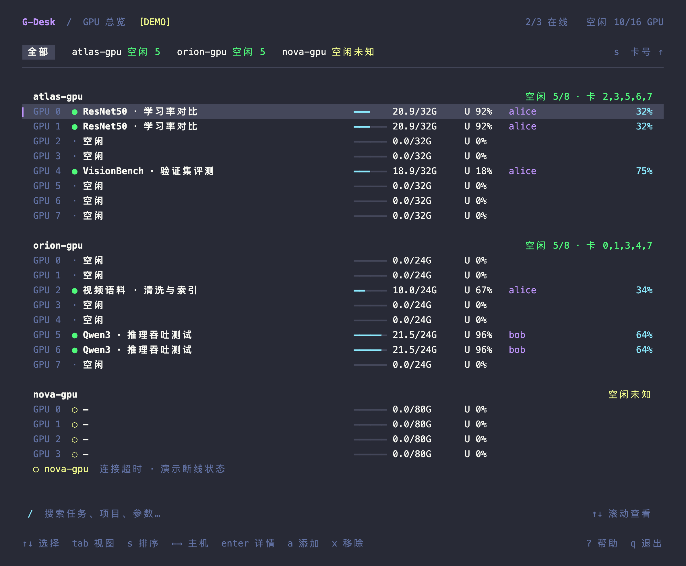
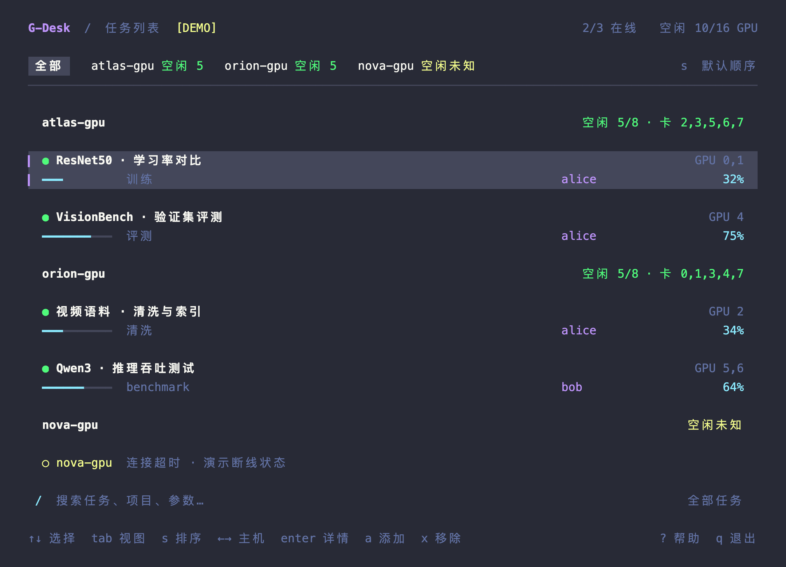
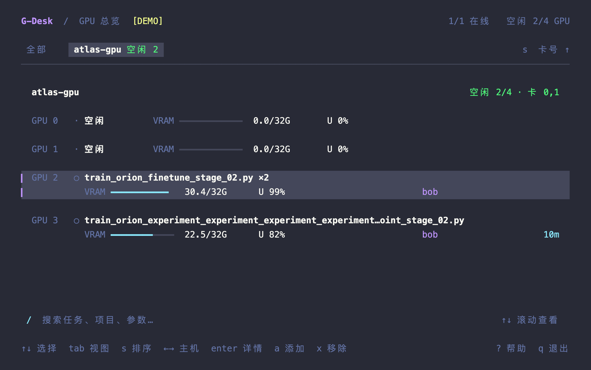

# G-Desk

多服务器 GPU 终端看板。查看空卡、任务、用户和进度。

[](https://github.com/mengdeerer/gdesk/actions/workflows/ci.yml)



截图全部使用虚拟数据。界面采用 Dracula 主题。

## 安装

从 [Releases](https://github.com/mengdeerer/gdesk/releases/latest) 下载对应系统的安装包，解压后执行：

```sh
mkdir -p "$HOME/.local/bin"
install -m 755 gdesk "$HOME/.local/bin/gdesk"
gdesk
```

若 `~/.local/bin` 不在 PATH 中，用 `~/.local/bin/gdesk` 启动。发布包附 SHA-256 校验文件。

已有 Go 1.26+ 也可直接安装：

```sh
GOBIN="$HOME/.local/bin" go install github.com/mengdeerer/gdesk/cmd/gdesk@latest
```

## 使用

首次启动输入 SSH 别名，例如 `atlas-gpu`。连接设置沿用本机 SSH 配置，新主机请先完成一次普通 SSH 登录。

本机支持 macOS、Linux，需要 OpenSSH。远端需要 Linux、Python 3、`nvidia-smi`。无需远端安装，也无需修改训练代码。

```sh
gdesk             # 查看服务器
gdesk --demo      # 虚拟演示
gdesk --check     # 采集诊断
gdesk --version   # 查看版本
```

「全部」视图每张卡一行：卡号、任务、显存、U 利用率、用户、进度或时长。选择单台服务器可看两行布局，Enter 查看完整详情。建议终端至少 80 列。

| 按键 | 操作 |
|---|---|
| `↑↓` / `j k` | 选择 |
| `←→` | 切换服务器 |
| `Enter` / `Esc` | 详情 / 返回；详情页也可按 `←` 返回 |
| `e` | 改名，再编辑说明；两次 Enter 保存 |
| `a` / `x` | 添加 / 移除服务器 |
| `Tab` | GPU / 任务视图 |
| `s` | 卡号 / 最近启动排序 |
| `/` / `m` | 搜索 / 只看我的任务 |
| `l` / `r` / `?` / `q` | 日志 / 刷新 / 帮助 / 退出 |

空闲候选卡须满足：观测新鲜、无计算进程、显存 ≤512 MiB、利用率 ≤5%。采集失败显示未知。看板只读，不预约或调度 GPU。

<details>
<summary>更多截图</summary>





</details>

## 配置

默认路径为 `~/.config/gdesk/config.json`，支持 `XDG_CONFIG_HOME`。改名和说明保存在同目录的 `annotations.json`。

```sh
gdesk --config-path                # 查看路径
gdesk --config ./custom.json       # 指定配置
gdesk --import-config ./config.json # 导入配置及标注
```

导入要求目标目录尚不存在；原文件保留。已有配置可直接用 `--config` 加载。

## 接入进度

默认显示进程名、用户和运行时长。需要进度与指标时，使用标准库 [TaskWriter](integrations/gpu_task.py)，并登记远端任务目录。

[接入指南](docs/integration.md) · [接入 skill](skills/gpu-desk-integration/SKILL.md) · [配置示例](examples/config.json) · [架构与协议](docs/implementation-plan.md)

## 开发

```sh
make build       # bin/gdesk
make demo
make install     # ~/.local/bin/gdesk
make test
go vet ./...
go test -race ./...
```

[设计规范](DESIGN.md)。生成演示页面与发布包：

```sh
python3 scripts/render_preview.py --width 124 --height 38
python3 scripts/build_release.py --version v0.1.1
```

暂不支持任务调度、历史指标、跨机器任务合并、容器 PID 映射及 MIG/MPS 专门适配。
